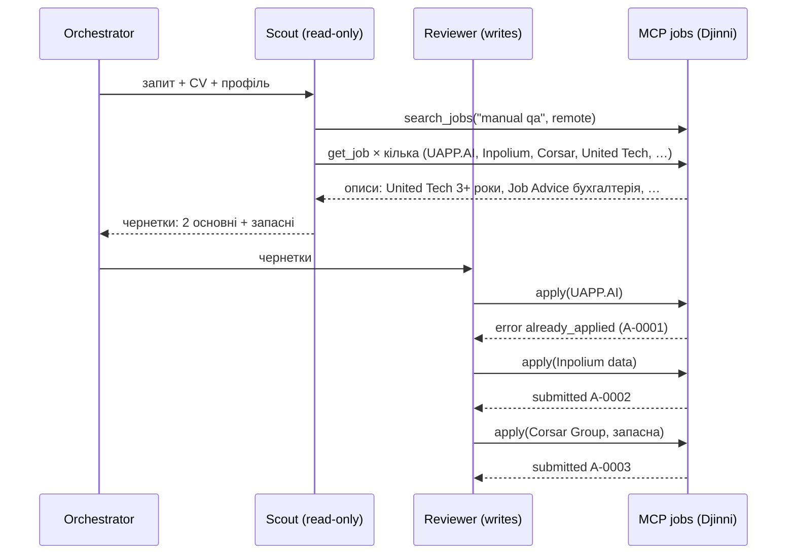

# Архітектура


Файл для слайда: [`architecture.svg`](architecture.svg) (вектор) і [`architecture.png`](architecture.png) (1280×720).

## Хто що може

| | `search_jobs` | `get_job` | `apply` | Промпт |
|---|---|---|---|---|
| **Scout** (агент A) | так | так | **ні** (немає в списку інструментів, і сервер відмовить із `forbidden`) | знайти й підготувати; ціль: покриття й повнота |
| **Reviewer** (агент B) | ні | так | **так, єдиний** | перевірити й не пропустити зайве; ціль: відмовити, коли чернетка сумнівна |
| **Single agent** (базова лінія) | так | так | так | усе разом: шукає, пише, перевіряє сам себе |
| Оркестратор | не LLM, а звичайний Python: передає чернетки від Scout до Reviewer, дозволяє один раунд правок | | | |

Два агенти відрізняються **промптами** (різна ціль), **інструментами** (різні списки) і **правом писати** (рівно один).

## Чому розподіл саме такий

1. **Хто хоче результат, той не тисне на незворотну кнопку.** Scout мотивований знайти й оформити. Коли та сама модель у тому самому контексті вирішує ще й «відправляти чи ні», вона схильна виправдовувати власну чернетку. Reviewer читає чернетку свіжими очима, порівнює з CV, описом вакансії й запитом і має право відмовити.
2. **Відгук змінює стан і не відкликається**, тому доступ до `apply` мінімальний: один агент, один інструмент.
3. **Захист у два шари.** Перший: у Scout немає `apply` у списку інструментів (`allowed_tools` / `disallowed_tools`). Другий: сервер знає `AGENT_ROLE` кожного підключення й сам відмовляє ролі `scout` (`forbidden`). Якщо хтось помилиться в конфігурації агента, запис усе одно не станеться. Тест `test_scout_cannot_write_and_nothing_is_written` перевіряє це через справжній MCP-клієнт.
4. **Поля з Djinni не можна сприймати на віру.** `work_mode` і `experience_years` парсер бере з розмітки сторінки. У знімку є офісне стажування в Києві з позначкою `remote` і «work from anywhere» з позначкою `hybrid`. Тому `search_jobs` віддає лише коротку картку без `is_open`, обидва агенти мусять відкрити кожну вакансію через `get_job` і прочитати опис, а Reviewer перевіряє ще раз перед відправкою.
5. **Агенти не перевантажені.** В оригіналі `jobs_helper_MCP` агенти мали ще сервер LinkedIn (до 6 інструментів), писали повне адаптоване CV для кожної вакансії, а `get_job` додавав оцінку відповідності, червоні прапорці й записи активності. Тут у кожного агента 2–3 інструменти, агент пише лише короткий лист, а сервер сам додає власне CV кандидата й контакти з профілю. Деталі в README, розділ «Що змінено порівняно з `jobs_helper_MCP`».

## Звідки вакансії: тільки Djinni

| Режим | Звідки | Для чого |
|---|---|---|
| знімок (за замовчуванням) | [`data/snapshots/2026-10-17_djinni.json`](../data/snapshots/2026-10-17_djinni.json): 36 справжніх вакансій Djinni, зібраних 17.10.2026 (`jobs_helper/snapshot.py`) | оцінка й демо: відтворювано, однаково на кожному запуску |
| `live` (`--snapshot live` / `JOBS_SNAPSHOT=live`) | djinni.co прямо зараз: RSS `djinni.co/jobs/rss/?primary_keyword=…&employment=remote` і сторінка вакансії ([`jobs_helper/sources/djinni.py`](../jobs_helper/sources/djinni.py)) | справжній пошук; парсер покрито тестами на збережених відповідях Djinni (`tests/fixtures/`) |

Ідентифікатор вакансії: `djinni:<номер>-<slug>`. Сервер також приймає посилання `https://djinni.co/jobs/…` і номер вакансії. Посилання на DOU, LinkedIn чи сайти компаній відхиляються з `unsupported_source`.

**Що робить `apply`.** Заповнює mock-форму Djinni (`jobs_helper/apply/mock.py`): повідомлення рекрутеру, ім'я, email і LinkedIn з `candidate.yaml`, власне CV кандидата з `cv.md`. Потім діє за політикою відправки, яку кандидат обрав у `settings.yaml` (`manual` → `awaiting_user`, `confirm` → `submitted` / `declined`, `auto` → `submitted`, `JOBS_DRY_RUN` → `prepared`), і записує рядок у трекер `workspace/applications.csv` разом із копіями листа й CV. Кнопку на djinni.co він **не натискає**: для міні-проєкту стан змінюється саме цим рядком, а справжню відправку через браузер робить оригінальний `jobs_helper_MCP`. Поля форми взято з розвідки оригіналу (`01_recon/RECON.md`): додаткових питань, як в ATS, на Djinni немає.

## Інструменти (MCP-сервер `jobs`, [`jobs_helper/mcp_jobs/server.py`](../jobs_helper/mcp_jobs/server.py))

| Інструмент | Тип | Що повертає |
|---|---|---|
| `search_jobs(keywords, remote?, min_salary?, max_experience_years?, limit?)` | читання | короткі картки Djinni: `job_id`, посилання, категорія, формат, рівень, роки, англійська, зарплата (`null` = не вказано) |
| `get_job(job_id)` | читання | вакансія: опис (до 3000 символів), роки, англійська, `valid_through`, `is_open` (і `similar_open_jobs`, якщо закрита) |
| `apply(job_id, cover_letter)` | **запис** | `{ok, status, application_id, url, policy}` і новий рядок у трекері |

Помилка завжди має вигляд `{error, message, hint, retryable}` і не валить сервер:

| `error` | Коли | Що робить агент |
|---|---|---|
| `forbidden` | роль без права запису | передає чернетку Reviewer |
| `unsupported_source` | посилання не на Djinni (DOU, LinkedIn, сайт компанії) | шукає схожу вакансію на Djinni |
| `invalid_job_id` / `job_not_found` | неправильний id або немає такої вакансії | бере `job_id` з `search_jobs` |
| `job_closed` | вакансію закрито на Djinni | не повторює; якщо користувач назвав саме її, повідомляє й пропонує `similar_open_jobs` |
| `already_applied` | відгук уже є | не дублює, бере запасну вакансію |
| `cover_letter_too_short` / `_too_long` | 200–1800 символів (наше правило) | виправляє повідомлення, повторює один раз |
| `candidate_profile_incomplete` / `_missing` | для форми Djinni бракує імені, email чи CV | не вигадує контакти, питає кандидата |
| `invalid_argument` | порожні або неправильні аргументи | виправляє виклик |
| `server_misconfigured` / `internal_error` | неправильні `JOBS_*` або збій | не повторює / повторює один раз |

## Як агент потрапляє до інструментів

Агент **не імпортує** функції з `service.py`. [`jobs_helper/agents/runtime.py`](../jobs_helper/agents/runtime.py) запускає агента через Claude Agent SDK і підключає MCP-сервер як stdio-підпроцес (`python -m jobs_helper.mcp_jobs.server`) з `AGENT_ROLE` цього агента. Агент бачить лише свої інструменти `mcp__jobs__*`. Вбудовані інструменти Claude Code вимкнено (`tools=[]`), налаштування користувача не читаються (`setting_sources=[]`), інші MCP-сервери заборонені (`strict_mcp_config`, `--no-chrome`), а хук `PreToolUse` відхиляє виклик будь-чого поза своїм списком.

## Трейсинг

Кожна подія пишеться в `runs/<run>/trace.jsonl`:

- `run_start`;
- `agent_start`;
- `agent_init` (модель, видимі інструменти);
- `tool_call`;
- `tool_result` (з кодом помилки);
- `assistant_text`;
- `handoff`;
- `agent_end` (ходи, токени, ціна);
- `run_end`.

Події `tool_call` і `tool_result` пишуть хуки SDK, тому вони збігаються з тим, що справді пройшло через MCP. Окремо сервер веде аудит `workspace/mcp_calls.jsonl`: роль, інструмент, результат. Оцінка читає саме його, а не слова агента.

```
uv run python scripts/trace_view.py runs/<run>/trace.jsonl   # пише trace.html (таймлайн) поруч із трейсом
uv run python -m jobs_helper.agents.run ...                  # живий кольоровий лог у консолі під час запуску
```

## Приклад проходу (c5: «Відгукнись на 2 найкращі remote manual QA вакансії на Djinni», на UAPP.AI уже є відгук)


