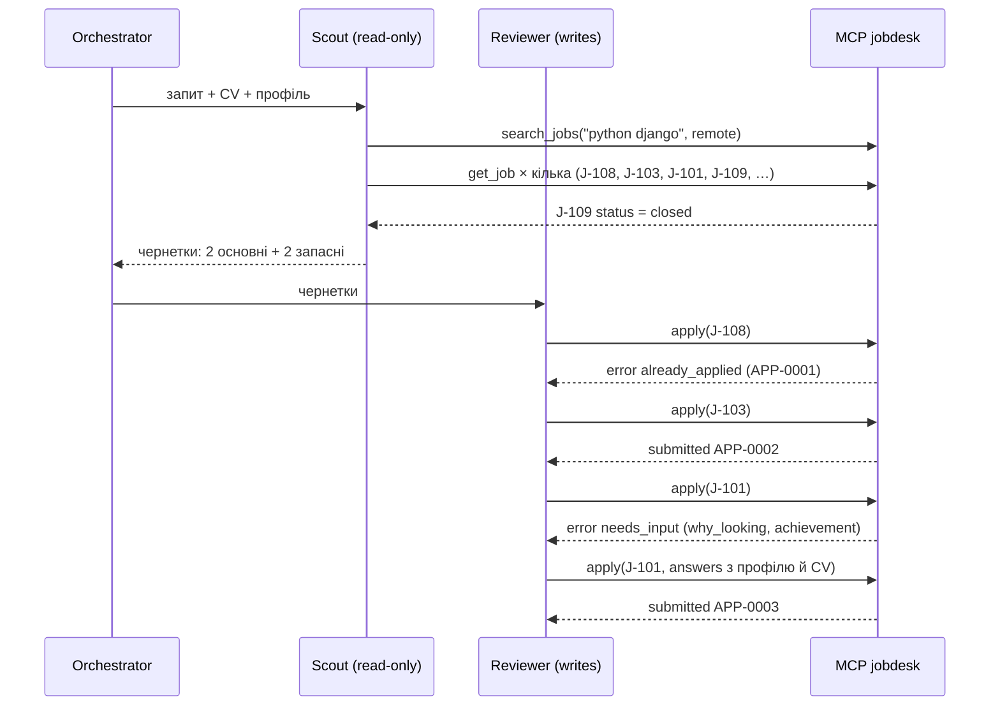

# Архітектура


Файл для слайда: [`architecture.svg`](architecture.svg) (вектор) і [`architecture.png`](architecture.png) (1280×720).

## Хто що може

| | `search_jobs` | `get_job` | `apply` | Промпт |
|---|---|---|---|---|
| **Scout** (агент A) | так | так | **ні** (немає в списку інструментів, і сервер відмовить із `forbidden`) | знайти й підготувати; винагорода за покриття й повноту |
| **Reviewer** (агент B) | ні | так | **так, єдиний** | перевірити й не пропустити зайве; винагорода за відмову, коли чернетка сумнівна |
| **Single agent** (базова лінія) | так | так | так | усе разом: шукає, пише, перевіряє сам себе |
| Оркестратор | не LLM, а звичайний Python: передає чернетки від Scout до Reviewer, дозволяє один раунд правок | | | |

Два агенти відрізняються **промптами** (різна ціль), **інструментами** (різні списки) і **правом писати** (рівно один).

## Чому розподіл саме такий

1. **Хто хоче результат, той не тисне на незворотну кнопку.** Scout мотивований знайти й оформити. Коли та сама модель у тому самому контексті вирішує ще й «відправляти чи ні», вона схильна виправдовувати власну чернетку. Reviewer читає чернетку свіжими очима, порівнює з CV і запитом і має право відмовити.
2. **`apply` змінює стан і не відкликається**, тому доступ до нього мінімальний: один агент, один інструмент.
3. **Захист у два шари.** Перший шар: у Scout немає `apply` у списку інструментів (`allowed_tools` / `disallowed_tools`). Другий: сервер знає `AGENT_ROLE` кожного підключення й сам відмовляє ролі `scout` (`forbidden`). Якщо хтось помилиться в конфігурації агента, запис усе одно не станеться. Тест `test_scout_cannot_write_and_nothing_is_written` перевіряє це через справжній MCP-клієнт.
4. **Індекс пошуку навмисно «застарілий».** `search_jobs` не показує, чи вакансія ще відкрита. Це змушує Scout відкривати кожну вакансію через `get_job`, а Reviewer перевіряти ще раз перед відправкою. Закрита вакансія дає відновлюваний `job_closed` із переліком схожих відкритих.
5. **Форма відгуку має власні питання.** `apply` повертає `needs_input` зі списком питань. На питання з `human_only: true` (наприклад, «чи є у вас родичі в компанії?») агент не має права відповідати сам: сервер відхилить відповідь (`human_only_question`), питання йде кандидату.

## Інструменти (MCP-сервер `jobdesk`, `jobdesk/server.py`)

| Інструмент | Тип | Що повертає |
|---|---|---|
| `search_jobs(keywords, remote?, min_salary?, max_experience_years?, limit?)` | читання | короткі картки з `job_id`, стеком, вилкою, вимогою до років (`null` = не вказано) |
| `get_job(job_id)` | читання | жива картка: опис, вимоги, `status: open \| closed` |
| `apply(job_id, cover_letter, answers?)` | **запис** | `{status: "submitted", application_id}` і новий рядок у `applications.csv` |

Помилка завжди має вигляд `{error, message, hint, retryable}` і не валить сервер:

| `error` | Коли | Що робить агент |
|---|---|---|
| `forbidden` | роль без права запису | передає чернетку Reviewer |
| `unknown_job` | немає такого id | бере id з `did_you_mean` |
| `job_closed` | вакансію закрито | бере одну з `similar_open_jobs` або запасну |
| `already_applied` | відгук уже є | не дублює, бере запасну вакансію |
| `cover_letter_too_short` / `_too_long` | 200–1800 символів | виправляє лист, повторює один раз |
| `needs_input` | форма має обов'язкові питання | відповідає з профілю й CV, повторює з `answers` |
| `human_only_question` | відповідь на питання тільки для людини | прибирає відповідь, питання йде кандидату |
| `invalid_input` | порожні або неправильні аргументи | виправляє виклик |

## Як агент потрапляє до інструментів

Агент **не імпортує** функції з `store.py`. `jobdesk/runtime.py` запускає агента через Claude Agent SDK і підключає MCP-сервер як stdio-підпроцес (`python -m jobdesk.server`) із `AGENT_ROLE` цього агента. Агент бачить лише 3 інструменти `mcp__jobdesk__*`: вбудовані інструменти Claude Code вимкнено (`tools=[]`), налаштування користувача не читаються (`setting_sources=[]`), інші MCP-сервери заборонені (`strict_mcp_config`, `--no-chrome`, а хук `PreToolUse` відхиляє виклик будь-чого поза `jobdesk`).

## Трейсинг

Кожна подія пишеться в `runs/<run>/trace.jsonl`: `run_start`, `agent_start`, `agent_init` (модель, видимі інструменти), `tool_call`, `tool_result` (з кодом помилки), `assistant_text`, `handoff`, `agent_end` (ходи, токени, ціна), `run_end`. Події `tool_call` і `tool_result` створюють хуки SDK, тому вони збігаються з тим, що справді пройшло через MCP. Окремо сервер пише аудит `mcp_calls.jsonl`: роль, інструмент, результат. Оцінка читає саме його, а не слова агента.

```
uv run python scripts/trace_view.py runs/<run>/trace.jsonl              # у терміналі
uv run python scripts/trace_view.py runs/<run>/trace.jsonl --html t.html  # HTML-сторінка
```

## Приклад проходу (запит c5: «Відгукнись на 2 найкращі remote Python/Django вакансії», на J-108 уже є відгук)


